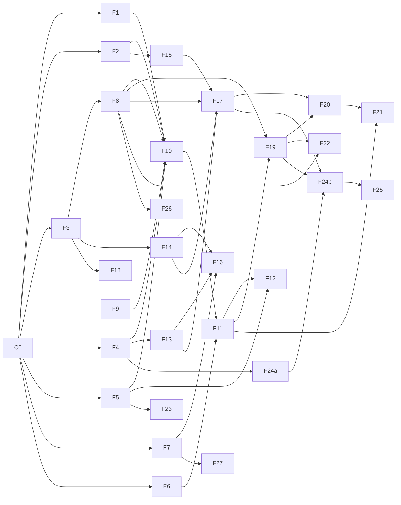

# Git Manager — Feature plan

This plan splits the delivery plan in [spec.md](spec.md) (M1 to M5) into features that
separate agents can build at the same time, maps their dependencies, and orders them into
waves. It does not authorize implementation: each milestone still starts only when the
user asks for it (see `AGENTS.md`).

## Starting point

Already on `main` / `chore/initial-scaffold`: `Settings` and the `Target` sum type, the
`Operations` protocol with only `health`, `Service`, `HttpOperations`, the CLI composition
root with local and API modes, and stub FastAPI and FastMCP apps. No domain code exists
yet (`config/`, `store/`, `branches/`, `rebasing/` and the rest of the spec's layout).

## How features stay independent

Parallel work fails on shared files, not on shared ideas. Four rules keep features apart:

1. **Contracts first.** One small feature (C0) lands every value model and protocol from
   the spec before anything else. After it, features depend on *protocols*, not on each
   other's code, and test against fakes. A "soft" dependency below means only the C0
   protocol is needed; a "hard" one needs the other feature's real implementation.
2. **Operations split by domain.** C0 turns `Operations` into a composition of small
   protocols (`BranchOperations`, `RunOperations`, `ApprovalOperations`, ...), each in its
   domain's module. A feature adds methods to its own protocol, its own service module and
   its own router, so two features never edit the same file.
3. **Dependencies added once.** C0 adds the spec's remaining libraries (`sqlmodel`,
   `ruamel.yaml`, `croniter`, `sse-starlette`) so `pyproject.toml` and `uv.lock` do not
   conflict in every wave.
4. **End to end after M2.** Until F11 lands, operations exist in `Service` and the local
   CLI only; F11 backfills REST and `HttpOperations` for them. Every feature after F11
   ships its operation in `Operations`, `Service`, REST, `HttpOperations` and the CLI
   together, with the shared contract tests.

## Features

IDs are stable; use them in branch names and session titles.

### Wave 0: contracts (one agent, blocks everything)

| ID | Feature | Domain | Scope |
| --- | --- | --- | --- |
| C0 | Domain contracts | all | Value models (`BranchState`, `TrackedBranch`, `StackInfo`, `BranchHeads`, `Run`, `VerifyCommands`, `ClaudeUsage`, `ConflictResolution`, `Approval`, `FailedRebase`, `ResolutionSession`, `Event`, `Actor`, `Scope`), the repo config schema (every section with defaults, sensitive keys marked), infra protocols (`ProcessRunner`, `Clock`, `IdGenerator`) with fakes in `tests/conftest.py`, per-domain protocols (`Git`, `Store` repositories, `Verifier`, `EventSink`, `ClaudeInvoker`), the `Operations` split, new dependencies |

### Wave 1: M1 foundations (parallel, each needs only C0)

| ID | Feature | Domain | Scope |
| --- | --- | --- | --- |
| F1 | Config loading | `config/` | YAML load, `defaults:` and per-branch merge, `GM_*` overrides, `trust_repo_config`, atomic ruamel write-back preserving comments, `config validate` / `show` |
| F2 | State store | `store/` | SQLite at `/data/state.db`, repositories behind the C0 protocols, migrations, exclusive data-directory lock and its "use API mode" error |
| F3 | Git adapter | `rebasing/` | Subprocess git over `ProcessRunner`: `ls-remote`, fetch, worktree add/remove, `rebase --onto` with rerere, conflict listing, `merge-base --is-ancestor`, `push --force-with-lease`, local `gm/attempt/*` branches. Integration tests on throwaway repos |
| F4 | Container and isolation | `isolation/` + Docker | Dockerfile (git, node + claude, gh + gh-stack pinned, just, make), the three users, PID 1 supervisor, isolated `ProcessRunner` with scrubbed env, local fallback with warning, `compose.yaml` with the `dind` sidecar and mTLS certs |
| F5 | Event bus | `events/` | Emit on every state change, persist through the store protocol, in-process subscribers, event filter from `notify.on` |
| F7 | Verification runner | `verification/` | Run config-supplied `setup` / `test` / `lint` as `gm-tests`, timeout, `retries`, artifacts (tail 500 lines, JUnit XML), Docker env for `dind`, `gm.run` label cleanup. No discovery yet (F16) |

### Wave 2: M1 core loop (parallel)

| ID | Feature | Domain | Hard deps | Scope |
| --- | --- | --- | --- | --- |
| F8 | Individual rebase run | `rebasing/` | F3 | Lock, fetch, worktree, rewritten-base detection, `--onto` fork point, verify, auto-push or hand to approval, update `fork_point` / `last_*_sha`, restart on head move, `max_restarts`, `diverged_remote`. Uses F7, F2, F5 through protocols |
| F9 | Poller and cadence | `branches/` | — (soft F3) | `ls-remote` per interval, `behind` / `scheduled`, `immediate` / `debounce` / `cron` / `manual`, FIFO run queue (one run at a time), the "leaving stop states" table |

### Wave 3: M1 integration (one agent)

| ID | Feature | Hard deps | Scope |
| --- | --- | --- | --- |
| F10 | Service and local CLI | F1, F2, F4, F5, F8, F9 | Wire the M1 operations into `Service` (track, untrack, status, sync, pause, resume, runs, show, diff, logs), composition roots, `serve` daemon with poller, local-mode lock. **Ends M1** |

### Wave 4: M2 interfaces (parallel)

| ID | Feature | Hard deps | Scope |
| --- | --- | --- | --- |
| F6 | API auth and scopes | C0 | Tokens file, `read` / `operate` / `approve` scopes, FastAPI dependency, Unix socket listener with `gm-admin` group. Can start in wave 1 |
| F11 | REST mirror | F10, F6 | `/api/v1` routes for every operation, `HttpOperations` for them, typed error mapping (`403`, `409 stale`, validation), contract tests shared by both implementations. **Ends M2 with F12** |
| F12 | SSE and `watch --notify` | F5, F11 | `GET /api/v1/events`, `git-manager watch`, desktop notifier adapters (`osascript`, `notify-send`) behind a protocol. The notifier adapters can start in wave 1 |

### Wave 5: M3 building blocks (parallel)

| ID | Feature | Domain | Hard deps | Scope |
| --- | --- | --- | --- | --- |
| F13 | Claude invoker | `resolution/` | F4 | Command line from config (tools, limits, settings file), `runuser` / `prlimit` / `timeout`, JSON result parsing, limit and usage-limit classification, per-call `ClaudeUsage`. Can start in wave 1 against a fake runner |
| F14 | Repo guidance | `resolution/` | F3 | Collect root and nested `AGENTS.md` / `CLAUDE.md`, version rule (branch before run, new base if conflicted), skills and subagents copy, built-in prompt, `resolution_prompt_extra`. Can start in wave 1 |
| F15 | Budgets and usage | `budgets/` | F2 | Per-run caps, rolling daily and weekly budget, `waiting_budget` / `waiting_quota`, `usage`, `budget reset` (approve scope) |
| F18 | Commit rules | `commits/` | F3 | GitHub rules and classic protection client, pattern checks per rewritten commit, committer identity and date, re-signing, `git_config`, `signing_required` |
| F19 | Approvals | `approvals/` | F8, F11 | Approval contract bound to base and heads, `409 stale`, approve / reject / retry, recommendations, audit log with actor type, `approval_ttl` |

### Wave 6: M3 resolution (parallel)

| ID | Feature | Hard deps | Scope |
| --- | --- | --- | --- |
| F16 | Test-command discovery | F13, F14, F7 | Read-only extraction call, cache by hash, `verify show` / `verify confirm`, `needs_config`, `missing_tool`, commit conventions and hook commands |
| F17 | Resolver | F13, F14, F15, F8 | Per-conflict loop, size gate, validation (markers, path allowlist, lint), hooks on changed files, rerere, resolution report, `gm/attempt/*` on give-up, `fix_test_failures`. **Ends M3 with F16** (verify the M3 open questions in the spec first) |

### Wave 7: M4 (parallel)

| ID | Feature | Hard deps | Scope |
| --- | --- | --- | --- |
| F20 | Failure records and sessions | F17, F19 | Records for every non-push outcome, path A sessions (reserved worktree, `get_conflict`, `submit_resolution`, idle expiry), path B (`mark_addressed`, `dismiss`), `export` |
| F21 | MCP server | F11 (F20 for failure tools) | Hand-written tools for read and operate operations, resources, prompts `review_pending_rebase` and `fix_failed_rebase`, mount at `/mcp`, `mcp stdio` bridge. Never exposes approve-scope tools. Read and operate tools can start right after F11 |
| F22 | Retarget and rewritten base | F8, F19 | `retarget` (approve scope, refused on stacks, never MCP), `retargeting` state, `base_missing`, rewritten-base warning |
| F23 | Webhooks | F5 | ntfy, Slack, generic JSON sinks. Can start in wave 1 |
| F24a | gh stack spike and parser | F4 | Verify exit codes and worktree behavior on a real stack, `gh stack view --json` parser with recorded fixtures. Can start in wave 1 |
| F24b | Stack runs | F24a, F8, F17, F19 | Detection before every run, stack rebase, per-branch verify, one approval, `gh stack push`, `stack_partial_push`, exit-code handling. **Ends M4** |

### Wave 8: M5 hardening (parallel)

| ID | Feature | Hard deps | Scope |
| --- | --- | --- | --- |
| F25 | Crash recovery | F8, F24b | On start, abort in-progress rebases (`gh stack rebase --abort` for stacks) and discard run worktrees |
| F26 | Baseline tests | F7, F8 | Optional run on the new base, `baseline_red` |
| F27 | Docker modes | F4, F7 | Sysbox runtime and `host_socket` with its startup warning |
| F28 | Docs | all | README, `config.example.yaml`, operator guide |

## Dependency graph

Solid arrows are hard dependencies. Every feature also depends on C0.

**Critical path:** C0 → F3 → F8 → F10 → F11 → F19 → F20 → F21. F17 joins it at F20, so
the M3 building blocks (F13, F14, F15) must be done by the time F19 lands.

## Running the plan

**Branches** follow the `git-workflow` skill. Each milestone is one feature branch
(`feat/m1-core-loop`, `feat/m2-interfaces`, ...), and each feature above is a task on it:
work branch `work/<milestone>/<id>-<slug>` in `.worktrees/<milestone>--<id>-<slug>`, landed
as one squashed commit. C0 lands on `feat/m1-core-loop` first. A milestone's branch goes
to `main` as one pull request when the user asks; the next milestone branches from `main`
after that merge.

**Sessions.** One agent session per feature, each in its own worktree, given its row from
this file plus the spec sections it names. Keep a wave to about five concurrent sessions.
A feature starts when its hard dependencies have landed on the feature branch; it does
not wait for the rest of its wave.

**Landing order inside a wave** matters only where features share wiring. Land the
smaller feature first; the other rebases onto the feature branch and re-runs `just check`
before its squash commit.

**Done means** `just check` passes on the work branch after rebasing, the feature's
operations have unit tests against fakes and, for adapters (git, store, supervisor), an
integration test across the real boundary.

### Schedule at a glance

| Wave | Milestone | Features (parallel within a wave) | Max sessions |
| --- | --- | --- | --- |
| 0 | M1 | C0 | 1 |
| 1 | M1 | F1, F2, F3, F4, F5, F7 | 6 |
| 2 | M1 | F8, F9 | 2 |
| 3 | M1 | F10 | 1 |
| 4 | M2 | F6, F11, F12 | 2 (F6 before F11) |
| 5 | M3 | F13, F14, F15, F18, F19 | 5 |
| 6 | M3 | F16, F17 | 2 |
| 7 | M4 | F20, F21, F22, F23, F24a then F24b | 5 |
| 8 | M5 | F25, F26, F27, F28 | 4 |

### Pulling work forward (needs a decision)

Waves 2 and 3 have little parallelism. Six features need nothing from M1 beyond C0 and
could run in waves 1 to 3 to shorten the whole plan: F6 (auth), F12's notifier adapters,
F13 (Claude invoker against a fake runner), F14 (guidance), F23 (webhooks) and F24a (gh
stack spike). Doing so starts M2, M3 and M4 work before those milestones are asked for,
so it needs the user's go-ahead. Their branches would live on their own milestone branch
and wait there until that milestone opens.
