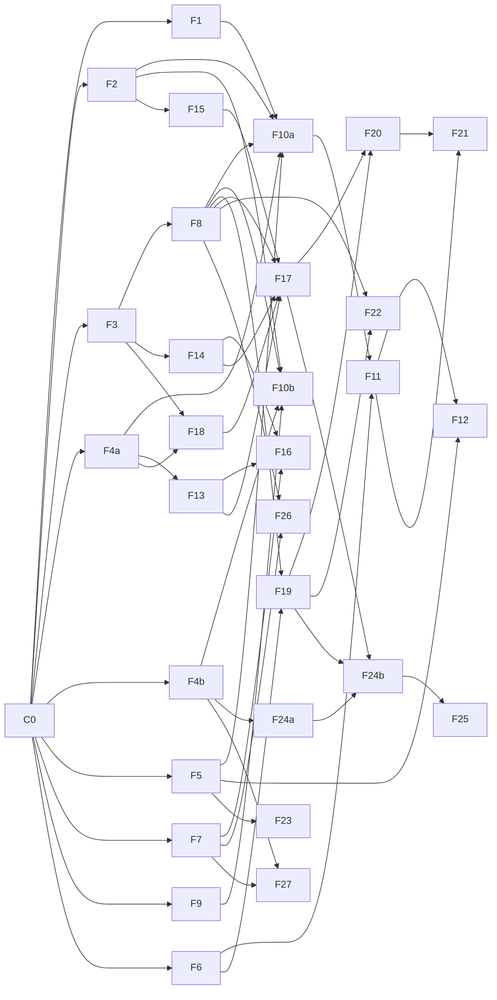

# Git Manager — Feature plan

This plan splits the delivery plan in [spec.md](spec.md) (M1 to M5) into features that
separate agents can build at the same time, maps their dependencies, and orders them into
waves. It does not authorize implementation: each milestone still starts only when the
user asks for it (see `AGENTS.md`).

## Starting point

On `main`: `Settings` and the `Target` sum type, the `Operations` protocol with only
`health`, `Service`, `HttpOperations`, the CLI composition root with local and API modes,
and stub FastAPI and FastMCP apps. No domain code exists yet (`config/`, `store/`,
`branches/`, `rebasing/` and the rest of the spec's layout).

## How features stay independent

Parallel work fails on shared files, not on shared ideas. Five rules keep features apart:

1. **Contracts open each milestone.** A small contracts feature (C0 for M1, C3 for M3, C4
   for M4; M2's few types go in F6) lands that milestone's value models and protocols
   before anything else. After it, features depend on *protocols*, not on each other's
   code, and test against fakes. A "soft" dependency below means only the protocol is
   needed; a "hard" one needs the other feature's real implementation. Contracts are
   written one milestone at a time so later designs are not guessed before earlier code
   exists.
2. **Operations and CLI split by domain.** C0 turns `Operations` into a composition of
   small protocols (`BranchOperations`, `RunOperations`, ...), each in its domain, and
   moves CLI commands into per-domain modules under `cli/`. A feature adds to its own
   protocol, service module, router and command module, so two features rarely edit the
   same file. C0 updates the Interfaces section of the spec to match, since the spec
   defines `Operations` as one protocol.
3. **Fakes have one owner.** Fakes shared across domains (`ProcessRunner`, `Clock`,
   `IdGenerator`, `Git`, store repositories) go in `tests/conftest.py`, and only the
   milestone's contracts feature edits that file. Fakes used by one domain go in that
   domain's `tests/<type>/<domain>/conftest.py`, which `just layout` allows.
4. **Dependencies added with contracts.** Each contracts feature adds its milestone's
   libraries (C0: `sqlmodel`, `ruamel.yaml`, `croniter`; F6: `sse-starlette`), so
   `pyproject.toml` and `uv.lock` do not conflict within a wave.
5. **End to end after M2.** Until F11 lands, operations exist in `Service` and the local
   CLI only; F11 backfills REST and `HttpOperations` for them. Every feature after F11
   ships its operation in `Operations`, `Service`, REST, `HttpOperations` and the CLI
   together, with the shared contract tests.

## Features

IDs are stable; use them in branch names and session titles.

### Wave 0: M1 contracts (one agent, blocks M1)

| ID | Feature | Scope |
| --- | --- | --- |
| C0 | M1 contracts | Value models for M1 (`BranchState`, `TrackedBranch`, `BranchHeads`, `Run`, `TestResult`, `VerifyCommands`, `Event`, `Actor`), the repo config schema (every section with defaults, sensitive keys marked), infra protocols (`ProcessRunner`, `Clock`, `IdGenerator`), domain protocols (`Git`, store repositories, `Verifier`, `EventSink`, `ApprovalGate`), shared fakes, the `Operations` and CLI split, M1 dependencies, spec update |

### Wave 1: M1 foundations (parallel, each needs only C0)

| ID | Feature | Domain | Scope |
| --- | --- | --- | --- |
| F1 | Config loading | `config/` | YAML load, `defaults:` and per-branch merge, `GM_*` overrides, `trust_repo_config`, atomic ruamel write-back preserving comments, `config validate` / `show` |
| F2 | State store | `store/` | SQLite at `/data/state.db`, repositories behind the C0 protocols, migrations, exclusive data-directory lock and its "use API mode" error |
| F3 | Git adapter | `rebasing/` | Subprocess git over `ProcessRunner`: `ls-remote`, fetch, `merge-base`, worktree add/remove, `rebase --onto` with rerere, conflict listing, `merge-base --is-ancestor`, `push --force-with-lease`, local `gm/attempt/*` branches. Integration tests on throwaway repos |
| F4a | Isolated process runner | `isolation/` | `ProcessRunner` that asks the supervisor to run a command as `gm-claude` or `gm-tests` with a scrubbed environment and timeout; local fallback that runs as the current user and logs that isolation is off. Runs anywhere; Linux parts behind the protocol |
| F4b | Container image and supervisor | Docker | Dockerfile (git, node + claude, gh + gh-stack pinned, just, make), the three users, PID 1 supervisor keeping only the four capabilities, `compose.yaml` with the `dind` sidecar, mTLS certs readable only by `gm-tests` |
| F5 | Event bus | `events/` | Emit on every state change, persist through the store protocol, in-process subscribers, event filter from `notify.on` |
| F7 | Verification runner | `verification/` | Run config-supplied `setup` / `test` / `lint` as `gm-tests`, timeout, `retries`, artifacts (tail 500 lines, JUnit XML), Docker env for `dind`, `gm.run` label cleanup. Missing commands mean `needs_config`; discovery from `AGENTS.md` comes in F16 |

### Wave 2: M1 core loop (parallel)

| ID | Feature | Domain | Hard deps | Scope |
| --- | --- | --- | --- | --- |
| F8 | Individual rebase run | `rebasing/` | F3 | Lock, fetch, worktree, `--onto` fork point, verify, push with lease, update `fork_point` / `last_*_sha`, restart on head move, `max_restarts`, `diverged_remote`. A run that needs approval (`approval_policy: always`) stops at the `ApprovalGate` in `awaiting_approval`; F19 completes it. A base that is not a descendant of `last_base_sha` stops in `needs_human` with reason `rewritten_base` until F22. Uses F7, F2, F5 through protocols |
| F9 | Poller and cadence | `branches/` | — (soft F3) | `ls-remote` per interval, `behind` / `scheduled`, `immediate` / `debounce` / `cron` / `manual`, FIFO run queue (one run at a time), the "leaving stop states" table |

### Wave 3: M1 integration (parallel)

| ID | Feature | Hard deps | Scope |
| --- | --- | --- | --- |
| F10a | Service and local CLI | F1, F2, F4a, F5, F8 | M1 operations in `Service` (track with the initial fork point from `merge-base`, untrack, status, sync, pause, resume, runs, show, diff, logs), local-mode composition root and lock |
| F10b | Daemon | F2, F4b, F8, F9 | `serve` composition root: poller loop feeding the run queue, data-directory lock, graceful shutdown, container entry point. **Ends M1 with F10a** |

### Wave 4: M2 interfaces

| ID | Feature | Hard deps | Scope |
| --- | --- | --- | --- |
| F6 | API auth and scopes | C0 | M2 types, tokens file, `read` / `operate` / `approve` scopes, FastAPI dependency, Unix socket listener with `gm-admin` group, `sse-starlette` |
| F11 | REST mirror | F10a, F6 | `/api/v1` routes for every operation, `HttpOperations` for them, typed error mapping (`403`, `409 stale`, validation), contract tests shared by both implementations |
| F12 | SSE and `watch --notify` | F5, F11 | `GET /api/v1/events`, `git-manager watch`, desktop notifier adapters (`osascript`, `notify-send`) behind a protocol. Split so it can start before F11: F12a (endpoint, `EventOperations` stream, notifiers) needs only F5; F12b (`watch` and the HTTP SSE client) needs F11. **Ends M2** |

### Wave 5: M3 contracts and building blocks

C3 lands first (one agent): `ClaudeUsage`, `ConflictResolution`, `Approval`,
`Recommendation`, the `ClaudeInvoker`, `GitHubRules` and `HookRunner` protocols and their
shared fakes. Then, in parallel:

| ID | Feature | Domain | Hard deps | Scope |
| --- | --- | --- | --- | --- |
| F13 | Claude invoker | `resolution/` | F4a | Command line from config (tools, limits, settings file), `prlimit` / `timeout` through the runner, JSON result parsing, limit and usage-limit classification, per-call `ClaudeUsage` |
| F14 | Repo guidance | `resolution/` | F3 | Collect root and nested `AGENTS.md` / `CLAUDE.md`, version rule (branch before run, new base if conflicted), skills and subagents copy, built-in prompt, `resolution_prompt_extra` |
| F15 | Budgets and usage | `budgets/` | F2 | Per-run caps, rolling daily and weekly budget, `waiting_budget` / `waiting_quota`, `usage`, `budget reset` (approve scope) |
| F18 | Commit rules and hooks | `commits/` | F3, F4a | GitHub rules and classic protection client, pattern checks per rewritten commit, committer identity and date, re-signing, `git_config`, `signing_required`, running confirmed hook commands on changed files as `gm-tests` |
| F19 | Approvals | `approvals/` | F6, F8 | Real `ApprovalGate`: contract bound to base and heads, `409 stale`, approve / reject / retry, recommendations, audit log with actor type, `approval_ttl` |

### Wave 6: M3 resolution (parallel)

| ID | Feature | Hard deps | Scope |
| --- | --- | --- | --- |
| F16 | Test-command discovery | F13, F14, F7 | Read-only extraction call, cache by hash, `verify show` / `verify confirm`, `missing_tool`, commit conventions and hook commands (run by F18) |
| F17 | Resolver | F13, F14, F15, F18, F8 | Per-conflict loop, size gate, validation (markers, path allowlist, lint, hooks through F18), rerere, resolution report, `gm/attempt/*` on give-up, `fix_test_failures`. Start by verifying the M3 open questions in the spec. **Ends M3 with F16** |

### Wave 7: M4

C4 lands first (one agent): `StackInfo`, `FailedRebase`, `ResolutionSession`, the
`GhStack` protocol and shared fakes. Then, in parallel:

| ID | Feature | Hard deps | Scope |
| --- | --- | --- | --- |
| F20 | Failure records and sessions | F17, F19 | Records for every non-push outcome, path A sessions (reserved worktree, `get_conflict`, `submit_resolution`, idle expiry), path B (`mark_addressed`, `dismiss`), `export` |
| F21 | MCP server | F11 (F20 for failure tools) | Hand-written tools for read and operate operations, resources, prompts `review_pending_rebase` and `fix_failed_rebase`, mount at `/mcp`, `mcp stdio` bridge. Never exposes approve-scope tools. Read and operate tools can start right after C4 |
| F22 | Retarget and rewritten base | F8, F19 | `retarget` (approve scope, refused on stacks, never MCP), `retargeting` state, rewritten-base runs with approval and warning (replacing F8's stop), `base_missing` |
| F23 | Webhooks | F5 | ntfy, Slack, generic JSON sinks |
| F24a | gh stack spike and parser | F4b | Verify exit codes and worktree behavior on a real stack, `gh stack view --json` parser with recorded fixtures |
| F24b | Stack runs | F24a, F8, F17, F19 | Detection before every run, stack rebase, per-branch verify, one approval, `gh stack push`, `stack_partial_push`, exit-code handling. **Ends M4** |

### Wave 8: M5 hardening (parallel)

| ID | Feature | Hard deps | Scope |
| --- | --- | --- | --- |
| F25 | Crash recovery | F8, F24b | On start, abort in-progress rebases (`gh stack rebase --abort` for stacks) and discard run worktrees |
| F26 | Baseline tests | F7, F8 | Optional run on the new base, `baseline_red` |
| F27 | Docker modes | F4b, F7 | Sysbox runtime and `host_socket` with its startup warning |
| F28 | Docs | all | README, `config.example.yaml`, operator guide |

## Dependency graph

Arrows are hard dependencies. Every feature also depends on its milestone's contracts
(C0, F6, C3 or C4).

**Critical path:** C0 → F3 → F8 → F10a → F11 → C3 → F13 → F17 → F20 → F21. F11 sits on it
only because of rule 5: M3 starts after M2.

## Running the plan

**Branches** follow the `git-workflow` skill. Each milestone is one feature branch
(`feat/m1-core-loop`, `feat/m2-interfaces`, ...), and each feature above is a task on it:
work branch `work/<milestone>/<id>-<slug>` in `.worktrees/<milestone>--<id>-<slug>`, landed
as one squashed commit. The milestone's contracts feature lands first. A milestone's
branch goes to `main` as one pull request when the user asks; the next milestone branches
from `main` after that merge.

**Sessions.** One agent session per feature, each in its own worktree, given its row from
this file plus the spec sections it names. Keep to about five concurrent sessions. A
feature starts when its hard dependencies have landed on the milestone branch; it does
not wait for the rest of its wave.

**Landing order inside a wave** matters only where features share wiring. Land the
smaller feature first; the other rebases onto the milestone branch and re-runs `just
check` before its squash commit.

**Done means** `just check` passes on the work branch after rebasing, the feature's
operations have unit tests against fakes and, for adapters (git, store, runner,
supervisor), an integration test across the real boundary.

### Schedule at a glance

| Wave | Milestone | Features (parallel within a wave) | Sessions |
| --- | --- | --- | --- |
| 0 | M1 | C0 | 1 |
| 1 | M1 | F1, F2, F3, F4a, F4b, F5, F7, F9 | 5 (F4a then F7 in one; F5 then F9 in one) |
| 2 | M1 | F8 | 1 (starts when F3 lands, overlapping wave 1) |
| 3 | M1 | F10a, F10b | 2 |
| 4 | M2 | F6, then F11, then F12 | 1 to 2 |
| 5 | M3 | C3, then F13, F14, F15, F18, F19 | 5 |
| 6 | M3 | F16, F17 | 2 |
| 7 | M4 | C4, then F20, F21, F22, F23, F24a, then F24b | 5 |
| 8 | M5 | F25, F26, F27, F28 | 4 |

F9 moved into wave 1: it needs only the `Git` protocol for `ls-remote`, so it can run next
to F3 instead of after it.

### Pulling work forward (not planned)

M2 is mostly serial (F6, F11, F12). Some later features need nothing from M1 beyond C0 and
could fill that gap: F6, F12's notifier adapters, F13 and F14 against fakes, F23 and F24a.
This plan keeps them in their milestones because `AGENTS.md` starts a milestone only when
the user asks. To pull any forward, the user names it, and it lands on its own
milestone's branch.
