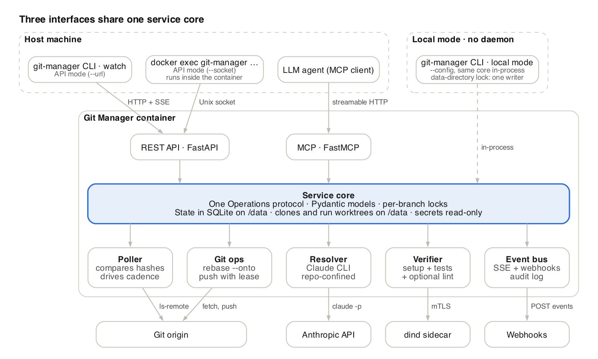
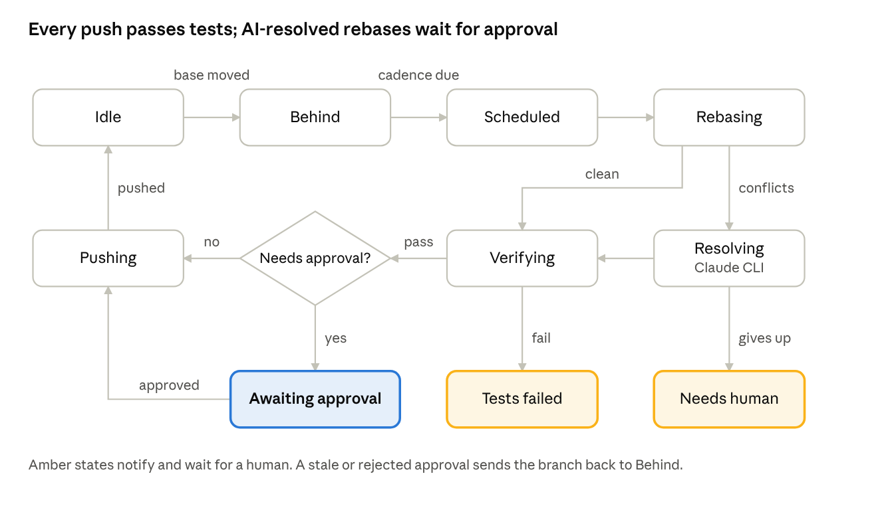

# Git Manager — Spec

> Exported from the living spec on Oct 23, 2026: <https://claude.ai/artifact/XFvtJJQDxLE2feETM9dykn>. Edit there or here, and keep both in sync.

## Overview

Git Manager is a containerized service that keeps long-lived feature branches rebased on their base branch, uses Claude CLI to resolve conflicts, proves the result with the test suite, and pushes, holding for human approval whenever an AI had to change code.

Keeping branches rebased is the first operation. The name is deliberately broader: other git operations can be added later on the same core, interfaces and container. The CLI is `git-manager`, which git also runs as `git manager`.

**Goals**

- Detect base-branch movement by comparing remote commit hashes, with no webhooks required.
- Rebase on a configurable cadence; never push a branch whose tests fail.
- Resolve conflicts with Claude CLI, guided by the repo's `AGENTS.md`, with tools confined to the repo.
- Gate any AI-resolved rebase behind explicit human approval, with notifications reaching the host.
- Expose one core over three interfaces: REST (FastAPI), MCP (FastMCP), and CLI (cyclopts). The CLI runs every operation either in-process from a config file or through the REST API, which mirrors all of them.

**Non-goals (v1)**

- Opening or merging PRs, or editing PR metadata on GitHub/GitLab.
- Rebasing branches that other people are actively pushing to (detected and paused, not handled).
- Multiple repos per container: v1 runs one container per repo (run several containers for several repos).

## Your question: what if the base branch changes?

Recommendation: treat a base change as an explicit **retarget**, perform it with `git rebase --onto <new-base> <stored-fork-point> <branch>`, and always require approval before pushing.

The key enabler is that Git Manager stores a **fork point** (the base commit the branch currently sits on) per tracked branch, and updates it after every successful sync. Without it, a plain `git rebase new-base` would replay the old base's commits onto the new base too.

| Scenario | Detection | Behavior |
| --- | --- | --- |
| Base gets new commits (normal case) | `ls-remote` hash differs from last seen | Rebase on cadence (req. 4) |
| User retargets base (e.g. `develop` → `main`) | git-manager retarget via CLI or REST (approve scope); never MCP | `rebase --onto new-base fork-point`; state `retargeting`; approval always required, even if no conflicts |
| Base force-pushed / history rewritten | Old base hash is not an ancestor of new base hash | Use stored fork point with `--onto`; approval required; notify with a "base rewritten" warning |
| Base deleted on remote | `ls-remote` returns nothing for the ref | Pause branch, state `base_missing`, notify; no automatic fallback |
| Base renamed | Looks like deletion + new ref | Same as deleted; user runs `retarget` to the new name |
| PR base changed on GitHub/GitLab | Not detected in v1 (no forge integration) | Future: optional forge plugin polls PR base and proposes a retarget |

**Decided:** no auto-retargeting in v1. A retarget is always a human action via CLI or REST, and always requires approval.

## Gap analysis

The nine requirements cover the happy path well; the gaps are mostly about history rewriting, concurrency with humans, and trust boundaries. Each gap below has a proposed default that the rest of this spec adopts.

| # | Gap | Why it matters | Proposed default |
| --- | --- | --- | --- |
| G1 | Push semantics after rebase | A rebase rewrites history, so a plain push fails and a plain force-push can erase a teammate's commits | Always `push --force-with-lease=<branch>:<last-seen-sha>`; never bare `--force` |
| G2 | Humans pushing to the same branch | The feature branch can move while a sync is running, or the dev has unpushed local commits | Poll the feature branch too; if it moved since the run started, abort and restart. Notify the dev after every push to `git pull --rebase` |
| G3 | How repos are "loaded" | Bind-mounting the dev's working copy risks clobbering their uncommitted work | Container clones its own copy into a named volume; host repo optionally used as `--reference` to speed cloning |
| G4 | Git credentials | Container must fetch and push | Mount an SSH deploy key or token as a read-only secret; per-repo override |
| G5 | Poll interval vs update cadence | Two different clocks were implied | `poll_interval` (detect) and `cadence` (act: immediate, debounce, cron window, manual) are separate settings |
| G6 | Test environment | Each repo needs its own toolchain inside the container | Commands read from `AGENTS.md` (or set in config) and confirmed by a human; base image with git, uv, Node, just, make; Docker sidecar for container tests |
| G7 | Tests failing before the rebase | A red baseline would be blamed on the rebase | Optional baseline run on the base commit; result recorded and shown with the diff |
| G8 | Clean rebase but tests fail (semantic conflict) | Not covered by req. 5 | Default: no AI fix, state `tests_failed`, notify. Opt-in `fix_test_failures` lets Claude try, which then requires approval |
| G9 | AGENTS.md vs Claude CLI | Claude CLI natively reads `CLAUDE.md`, not `AGENTS.md` | Inject `AGENTS.md` via `--append-system-prompt`; fall back to a built-in resolution prompt when missing |
| G10 | "Tools only inside the repo" enforcement | Prompt instructions alone are not a boundary | Defense in depth: Claude permission rules + a per-run worktree + container with no host mounts and an egress allowlist |
| G11 | Claude cost and runaway runs | Unbounded turns on a hard conflict | `max_turns`, wall-clock timeout, model choice; give up to state `needs_human` |
| G12 | Approval goes stale | Base can move again while waiting | Approval binds to an exact (base sha, result sha). If base moves, the pending result is superseded; `git rerere` replays prior resolutions |
| G13 | Who may approve | An LLM approving LLM-written code via MCP | Humans only. MCP agents can review and attach a recommendation but cannot approve; enforced by token scopes |
| G14 | Reaching the host | A container cannot raise desktop notifications itself | Event stream (SSE) + webhooks (ntfy, Slack, generic); host CLI `git-manager watch --notify` raises OS notifications |
| G15 | API exposure | REST/MCP can push code | Publish only on host `127.0.0.1`; a token on every HTTP request; scoped tokens |
| G16 | Crash mid-rebase | Repo left in a half-rebased state | On startup, abort any in-progress rebase (gh stack rebase --abort for stack runs) and discard the run's worktree |
| G17 | Signed commits, merge commits, LFS, submodules | Rebase can break signatures or flatten merges | Configurable signing key; `--rebase-merges` opt-in; LFS and submodules supported via setup hooks, flagged as v1 limitations |

## Architecture

A single long-running container hosts the daemon; every interface calls the same service core, and only the worker modules touch git, Claude or the network.



The host only talks to the container through the API, the MCP endpoint or `docker exec`; the container never mounts the developer's working copy. The CLI can also run the same service core in-process from a config file, without a daemon (local mode; see Interfaces). Each sync runs in a throwaway `git worktree` under `/data`, so a crashed or rejected run leaves the managed clone untouched.

A `docker:dind` sidecar in the same compose project runs any containers the test suite needs. Only the gm-tests user can read its client certificates; see Verification for the setup.

## Sync lifecycle

Detection and action run on separate clocks: the poller checks hashes every `poll_interval` (default 60s), and the cadence decides when a detected change is acted on (default: after the base has been quiet for 10 minutes).



**Polling.** One `git ls-remote origin <base> <branch>` per tracked branch per interval; no fetch unless a hash changed. Comparing against `last_base_sha` detects base movement; comparing against `last_head_sha` detects humans pushing to the feature branch (G2).

**Cadence modes.** `immediate` (act on the next tick), `debounce` (default, wait until the base is quiet), `cron` (e.g. weekdays 06:00 so results are ready at the start of the day), `manual` (detect and notify only). `git-manager sync` always overrides the cadence.

**Rebase run.**

1. Take the branch lock; `git fetch` base and branch; create a worktree at the remote branch tip.
2. If the base is not a descendant of `last_base_sha`, mark the run `rewritten_base` (forces approval).
3. `git rebase --onto <new-base-sha> <fork_point>` with `rerere` on; `--rebase-merges` if configured.
4. Conflicts go to the Resolver (next section); a clean rebase goes straight to Verifying.
5. Tests green → push or wait for approval per the policy; then update `fork_point`, `last_base_sha`, `last_head_sha`.

**Interrupts.** If the remote feature branch moves mid-run, the run is aborted and restarted from the new tip. If the lease check fails at push time, the branch goes to `diverged_remote` and waits for a human. `git-manager pause` stops polling for a branch without losing state.

**Restart cap.** If the feature branch moves mid-run more than `max_restarts` times in a row (default 3), the branch is paused with reason `max_restarts` and you are notified. This is how "someone is actively pushing to it" from the non-goals is detected.

**Concurrency.** One run at a time per container in v1, queued first in, first out. A stack run counts as one run. Polling continues while a run is in progress.

**Leaving stop states**

| State | Leaves when |
| --- | --- |
| `tests_failed` | The base moves again (new run), or `git-manager retry` |
| `needs_human` | `git-manager retry` (optionally with a note for Claude), or `git-manager resume` after you push a fix yourself |
| `needs_config` | Test commands are set in config or confirmed with `git-manager verify confirm` |
| `diverged_remote` | `git-manager resume` once the remote branch is settled; the next run starts from its new tip |
| `base_missing` | The base reappears, or `git-manager retarget` |
| `stack_partial_push` | `git-manager retry` re-pushes the branches that did not update, with fresh lease checks |
| `waiting_budget` | The rolling budget resets, or `git-manager budget reset` |
| `waiting_quota` | The usage-limit reset time passes |
| `paused` | `git-manager resume` |

A base change while in `needs_human`, `needs_config`, `diverged_remote` or `paused` is recorded but does not start a run, so a stuck branch does not burn the Claude budget.

## Stacked branches (gh stack)

A tracked branch that belongs to a [gh stack](https://cdn.jsdelivr.net/gh/github/gh-stack@main/README.md) is always rebased as part of its stack, never on its own. Rebasing one middle branch onto trunk would leave every branch above it built on stale commits and break the stack's linear history, which GitHub requires for merging ([stacked PRs reference](https://docs.github.com/en/pull-requests/reference/stacked-pull-requests)).

**Detection**

1. gh-stack keeps its local metadata in `.git/gh-stack`, and the stack itself is stored on GitHub. The container's fresh clone has no local metadata, so detection asks GitHub, not the clone.
2. **Checked before every run.** Right before a rebase run starts, Git Manager runs `gh stack view --json` for the branch. A branch that was added to a stack since the last run is caught here and switched to the stack flow before anything is rebased. There is no separate background check.
3. Exit code 2 ("not in a stack") selects the individual flow. Exit code 6 (the branch is in more than one stack) sends it to `needs_human`.
4. The result (stack id, trunk, ordered branch list, position) is saved with the run. A change from the previous run, such as joining a stack or a branch being reordered, is noted in the run report and notified.
5. **Removed stacks are not polled for.** If a stack command reports the branch is no longer in a stack (exit code 2 from `gh stack rebase`), the run aborts cleanly, notifies "stack removed", and the next run uses the individual flow.
6. Branches stacked by hand (a PR's base is another feature branch, without gh stack) are not detected in v1. They are treated as individual branches with the base you configure.

**Choosing the flow**

| Situation | Flow | Notes |
| --- | --- | --- |
| Not in a stack | Individual rebase | The flow in Sync lifecycle, unchanged |
| In a stack, `stack.mode: auto` (default) | Stack rebase | The whole stack is one unit: one lock, one run, one approval |
| In a stack, `stack.mode: ignore` | Individual rebase | Opt-in; logs a warning that branches above will drift |
| Bottom PR already merged | Stack rebase | gh stack replays the remaining commits with `--onto`; merged branches are not pruned automatically |
| Whole stack merged | None | The branch goes to `idle` with reason `stack_merged`; you untrack it |

**Stack rebase run**

1. **Trigger.** The poller watches trunk and every branch in the stack. Trunk moving, or any lower branch changing, schedules one run for the whole stack using the cadence of the branch you tracked.
2. **Rebase.** In the run's worktree: `gh stack rebase --committer-date-is-author-date`. It fetches and rebases the stack in order from trunk up. `stack.scope: full` (default) rebases the whole stack; `downstack` stops at the tracked branch.
3. **Conflicts.** Exit code 3 means gh stack paused on a conflict. The conflicted branch goes to the Resolver with the same rules and confinement as an individual rebase, then `gh stack rebase --continue`. If the Resolver gives up, `gh stack rebase --abort` puts every branch back as it was.
4. **Verify.** `stack.test: all` (default) runs the test command on every rebased branch, bottom to top. `top` tests only the top branch. Every tested branch must pass.
5. **Approve.** One approval covers the whole stack. It records each branch's old and new head and is required whenever any branch needed Claude.
6. **Push.** `gh stack push` pushes all active branches with a per-branch `--force-with-lease`. That push is not atomic: if one branch is rejected, the others may already be updated. That case goes to state `stack_partial_push` and notifies, listing which branches did and did not update.
7. **Locking.** Exit code 8 (stack locked by another gh-stack process) re-queues the run. Exit code 2 mid-run means the stack was removed (see Detection). Exit code 4 (GitHub API failure) retries with backoff.

**What Git Manager does not use**

- `gh stack sync`: it pushes automatically and restores the branches on any conflict, which would bypass both the Resolver and the approval gate.
- `gh stack modify`, `submit`, `merge` and `unstack`: the stack's structure and PRs stay the developer's job.
- `git-manager retarget` on a stacked branch is refused. The base comes from the stack; change it with gh stack.
- GitHub's server-side "Rebase stack" button is not used, since it pushes without tests or approval.

**Requirements**

- `gh` 2.0+, the extension (`gh extension install github/gh-stack`, pinned to a version in the image) and Git 2.36+. Set `GH_STACK_NO_UPDATE_NOTIFIER=1`.
- A GitHub token (`GH_TOKEN`) mounted as a secret, with read/write access to the repo's contents and pull requests. It is available to the orchestrator only, never to Claude.
- Stacked PRs are in public preview. The `--json` output format is not documented yet, so the parser is isolated in one module and covered by tests against recorded output. M4 starts with verifying exit codes and behavior on a real stack, including whether gh stack rebase works from one per-run worktree and whether the clone needs a local branch for every stack member before the run.

## Conflict resolution with Claude CLI

Git Manager owns git; Claude only edits files. For each commit that stops the rebase, the orchestrator calls Claude headlessly, validates the result, and runs `git rebase --continue` itself.

**Per-conflict loop**

1. Rebase stops on commit *C*. Collect: conflicted paths, *C*'s message and diff, the upstream commits that touched those paths (`git log <old-base>..<new-base> -- <paths>`), and `AGENTS.md`.
2. Check the size gate (Claude limits, below). A conflict that is too large goes straight to `needs_human` without calling Claude.
3. Run Claude in the run's worktree as the `gm-claude` user, with every limit applied:

   ```bash
   runuser -u gm-claude -- prlimit --as=4G --nproc=256 --fsize=200M -- \
     timeout --kill-after=30s 15m \
     claude -p "$PROMPT" \
       --output-format json --model "$MODEL" \
       --max-turns 30 --max-budget-usd 2.00 \
       --no-session-persistence --strict-mcp-config \
       --setting-sources user --settings /etc/git-manager/claude-settings.json \
       --append-system-prompt "$(cat AGENTS.md)" \
       --tools "Read,Edit,Write,Glob,Grep,Bash,Skill" \
       --allowedTools "Read,Edit,Write,Glob,Grep,Skill,Bash(git diff:*),Bash(git log:*),Bash(git show:*),Bash(git status:*)" \
       --disallowedTools "WebFetch,WebSearch,Bash(git push:*),Bash(git rebase:*),Bash(git reset:*),Bash(git checkout:*),Bash(docker:*),Bash(curl:*),Bash(wget:*)"
   ```
4. Read the JSON result. An error result (`error_max_turns`, `error_max_budget_usd`, a usage limit) or a timeout counts as giving up. Edits Claude already made stay only in the throwaway worktree.
5. Validate: no conflict markers remain, only conflicted paths (plus an allowlist such as lockfiles) changed, optional per-repo `lint` command passes.
6. `git add` the paths, `git rebase --continue` (or `gh stack rebase --continue` in a stack run), record a resolution report for *C*, including turns, cost and tokens.
7. Repeat until the rebase finishes, or give up → abort the rebase, state `needs_human`.

**Confinement (defense in depth)**

- Working directory is a disposable `git worktree` for the run; the managed clone itself is never edited by Claude.
- Claude runs as its own Unix user, `gm-claude`, which cannot read `/run/secrets`, `/certs`, the API socket or other runs' worktrees (see Process isolation under Security).
- Only Git Manager's own settings file is loaded (`--setting-sources user` with an empty home, plus `--settings`). A `.claude/settings.json` committed in the repo, including any hooks or permissions it defines, is ignored.
- `claude-settings.json` denies `Read`/`Edit` outside the worktree, denies network tools, docker, `curl` and `wget`, and enables the Bash sandbox. No MCP servers are loaded.
- The container mounts no host paths besides the data volume and secrets, and runs with an egress allowlist.
- No credential except the Claude token is visible to Claude's process; git and GitHub credentials are used only by the orchestrator.

**Repo guidance: AGENTS.md, CLAUDE.md and skills**

- **Instructions:** `AGENTS.md` at the repo root (path configurable) plus nested `AGENTS.md` files in conflicted directories, and `CLAUDE.md` files in the same places, are injected with `--append-system-prompt`. Git Manager injects them itself so loading does not depend on which settings sources the CLI reads.
- **Skills:** the repo's `.claude/skills/` are copied into `gm-claude`'s home (`~/.claude/skills/`) for the run, so `--setting-sources user` loads them while the repo's `.claude/settings.json` (hooks, permissions) stays ignored. The `Skill` tool is allowed. Repo subagents in `.claude/agents/` are copied the same way.
- **Skill scripts:** a skill that needs to run its own scripts can only do so if that command is added to `claude.extra_allowed_tools` (sensitive config, approve scope). Everything else in the skill (instructions, references, templates) works as is.
- **Which version:** guidance comes from the branch being rebased, as it was before the run. If one of those files is itself in conflict, the new base's version is used.
- **Missing guidance:** with no `AGENTS.md` or `CLAUDE.md`, a built-in prompt is used: preserve the intent of both sides, prefer upstream for renamed or moved APIs, never delete tests to make things pass.
- A per-repo `resolution_prompt_extra` lets the user add rules without touching the repo.
- The same guidance and skills are loaded for the read-only extraction call (test commands and commit conventions).

**Resolution report** (stored and shown at approval): per file, the strategy taken, a one-paragraph rationale, Claude's self-rated confidence, and the diff vs. each side. `git rerere` is enabled so an approved resolution is replayed automatically if the same conflict recurs.

**Failed attempts stay local.** When the Resolver gives up or a human rejects, the partial result is kept as a local branch `gm/attempt/<branch>/<run-id>` in the container's clone and is never pushed. It is part of a failure record you can work on over MCP (see Failed rebases); `git-manager export RUN` also writes it as a patch to `/data/exports`.

**Claude authentication.** The default is a Claude subscription: run `claude setup-token` once on the host and mount the result as the `CLAUDE_CODE_OAUTH_TOKEN` secret. Setting `claude.auth: api_key` uses `ANTHROPIC_API_KEY` instead. `git-manager doctor` checks whichever is configured.

### Claude limits

Every Claude call is capped by the CLI itself, by the operating system and by Git Manager's own budget, so a hard conflict can never run away in turns, money, time or machine resources.

| Scope | Limit | How it is enforced | Default |
| --- | --- | --- | --- |
| Per call | Turns | `--max-turns` | 30 |
| Per call | Spend | `--max-budget-usd` (print mode only; includes subagents) | $2.00 |
| Per call | Wall clock | `timeout` around the process, then kill the process group | 15 min |
| Per call | Tools | `--tools` limits the built-in tools; `--strict-mcp-config` loads no MCP servers | Read, Edit, Write, Glob, Grep, Bash, Skill |
| Per call | Output and thinking tokens | `CLAUDE_CODE_MAX_OUTPUT_TOKENS`, `MAX_THINKING_TOKENS` | CLI defaults |
| Per call | Bash commands | `BASH_DEFAULT_TIMEOUT_MS`, `BASH_MAX_TIMEOUT_MS`, `BASH_MAX_OUTPUT_LENGTH` | 60 s, 120 s, 30,000 chars |
| Per call | Memory, processes, file size | `prlimit` on the `gm-claude` process | 4 GB, 256, 200 MB |
| Per run | Conflict size gate | Checked before calling Claude | 25 files or 1,500 conflict lines |
| Per run | Claude calls | One per conflicted commit | 10 |
| Per run | Spend | Sum of `total_cost_usd` from each JSON result | $5.00 |
| Rolling | Daily and weekly spend | Sum of recorded costs | $10 per day, $40 per week |

- **Hitting a per-call or per-run limit** counts as giving up: the rebase is aborted and the branch goes to `needs_human`, with the limit named in the report.
- **Hitting the rolling budget** puts runs that need Claude into `waiting_budget`. Clean rebases still proceed. The budget resets on schedule, or `git-manager budget reset` resets it by hand (approve scope).
- **Subscription usage limits.** When the CLI reports a usage or rate limit, the branch goes to `waiting_quota` and retries after the reset time it reports (or after 30 minutes), instead of `needs_human`.
- **Usage is recorded per call:** turns, `total_cost_usd`, input, output and thinking tokens, and duration. `git-manager usage` shows totals by day and by run.
- **To verify in M3:** whether `--max-budget-usd` stops calls under subscription auth as it does with an API key (cost is still reported either way), the exact behavior of the token and Bash environment variables, and that skills and subagents copied into the user directory load under --setting-sources user. The rolling budget is enforced by Git Manager regardless.

## Commits follow the repo's rules

Rebased commits keep their author, message and trailers. Git Manager changes only what a rebase has to, and checks the repo's own rules on every rewritten commit before anything is pushed.

**What is preserved and what changes**

| Field | Behavior | Setting |
| --- | --- | --- |
| Author name, email, date | Always preserved | — |
| Message and trailers (`Signed-off-by`, `Co-authored-by`) | Always preserved; Claude never edits messages | — |
| Committer identity | A configured bot identity by default | `commits.committer` |
| Committer date | Kept equal to the author date by default | `commits.committer_date: author \| now` |
| Signature | Lost on any rebase; re-signed if a key is configured | `repo.signing_key` |

**Rules read from GitHub.** Before each push, Git Manager reads the rules that apply to the branch (`GET /repos/{owner}/{repo}/rules/branches/{branch}` plus classic branch protection) and enforces them locally:

- `required_signatures`: a signing key must be configured. Without one, the branch goes to `needs_config` with reason `signing_required` before any rebase work starts.
- `commit_message_pattern`, `commit_author_email_pattern`, `committer_email_pattern`: every rewritten commit is checked; a mismatch fails the run with the offending commit named.
- `required_linear_history`: `--rebase-merges` is turned off for that branch.

**Conventions read from AGENTS.md.** The extraction call that finds the test commands also returns the repo's commit conventions (message format, DCO sign-off) and its hook commands (for example `pre-commit`, `lefthook`, `husky`, `commitlint`). They go through the same human confirmation as the test commands.

**Hooks.** Git does not run commit hooks during a rebase. For every commit whose content Claude (or a path A submission) changed, Git Manager runs the confirmed hook commands on the changed files as `gm-tests`. A failing hook counts as a failed validation.

**New commits.** Git Manager creates new commits only when `fix_test_failures` is on. Their messages follow the repo's conventions, include a sign-off if the repo uses DCO, pass any `commit-msg` hook, and carry a `Git-Manager-Run: <run-id>` trailer.

**Git settings.** `.gitattributes` (merge drivers, line endings) applies automatically. The repo's local `.git/config` is not versioned, so any git settings the repo relies on go in `commits.git_config`.

## Verification

A rebased branch is pushable only when the repo's test command exits 0 on the rebased tip, inside the run's worktree, within the timeout. The command is normally read from the repo's `AGENTS.md`, not hard-coded in Git Manager's config.

- **Commands:** `setup`, `test` and optional `lint`, resolved as described below (e.g. `just setup` / `just test` in a repo with a justfile, `uv run pytest -q` in another). They run as a non-root user with the same egress allowlist.
- **Timeout:** default 30 minutes; exceeding it counts as a failure.
- **Baseline (optional, default off):** run the same tests on the new base commit first. If the base is already red, the report says so and the run stops in `tests_failed` with reason `baseline_red` instead of blaming the rebase.
- **Flaky retries:** `test_retries` (default 0). A pass on retry is flagged in the report.
- **Artifacts kept per run:** the commands used and where they came from, exit code, duration, last 500 lines of output, JUnit XML if the command produces it.
- **Tests that need Docker:** served by a Docker-in-Docker sidecar (below), never by the host's Docker socket.

### Where the test commands come from

Git Manager assumes no task runner. `just`, `make`, `uv`, `npm` or a plain script are all valid; the repo says which through `AGENTS.md`.

| Priority | Source | When it applies |
| --- | --- | --- |
| 1 | `verify.setup` / `test` / `lint` in config | Set by hand; always wins |
| 2 | Extracted from `AGENTS.md` | Default (`verify.discover: agents_md`) |
| 3 | None | Branch goes to `needs_config` and notifies; nothing is pushed |

1. **Extraction.** A short, read-only Claude call reads `AGENTS.md` (plus nested ones) and any files it points to, such as a `justfile` or `Makefile`. It returns structured JSON: `setup`, `test`, `lint`, required tools (e.g. `just`, `docker`) and the line in `AGENTS.md` each command came from. Only `Read`, `Glob` and `Grep` are allowed in this call.
2. **Cache.** The result is cached by the hash of `AGENTS.md` and the files it read. It is re-extracted only when one of those changes.
3. **Human confirmation.** The first extracted command set, and any later change to it, must be confirmed with `git-manager verify confirm` (or REST with the `approve` scope) before it runs. These commands run with Docker access, so an `AGENTS.md` edit cannot silently change what executes. MCP agents can view the proposal but not confirm it.
4. **Which version.** Commands come from the `AGENTS.md` on the rebased tip. If the rebase changed them, the run uses the new set only after confirmation, and the approval report flags the change.
5. **Tools.** The base image ships `git`, `uv`, Node, `just` and `make`. A required tool that is missing fails the run with a clear `missing_tool` reason; `setup` can install others.
6. **No guessing.** Git Manager does not infer commands from a justfile or package.json on its own. `git-manager doctor` may list such candidates as hints, but they never run without being set in config or confirmed.

### Tests that need Docker

Tests that start containers (Testcontainers, `docker compose` fixtures) run against a dedicated `docker:dind` sidecar in the same compose project. Only the test step can reach it; Claude never can, because Docker access is effectively root wherever the daemon runs.

1. **Two services.** `gm` (Git Manager) and `dind` (the Docker daemon). `dind` listens on port 2376 with mutual TLS, only on the private compose network, and publishes no Docker port on the host.
2. **Same paths on both sides.** The `/data` volume (clone and worktrees) is mounted into `dind` at the same path, so bind mounts in test fixtures such as `./fixtures:/fixtures` resolve to the same files.
3. **Shared network namespace.** `gm` runs with `network_mode: service:dind`, so ports published by test containers appear on `localhost` and tests that hardcode `localhost:5432` keep working.
4. **Credentials only for the test step.** The verifier sets `DOCKER_HOST=tcp://localhost:2376`, `DOCKER_TLS_VERIFY=1` and `DOCKER_CERT_PATH` for `setup` and `test` only. The certificate files are readable only by the `gm-tests` user, which runs those commands with a scrubbed environment. Claude's user cannot read them, and its settings also deny docker.
5. **Cleanup after every run.** The verifier labels the run (`gm.run=<run-id>`, passed to tests as `GM_RUN_ID`) and removes leftover containers, networks and volumes afterwards. With `reset_between_runs: true` it also prunes everything older than the run. Testcontainers' Ryuk works unchanged.
6. **Image cache.** `/var/lib/docker` in `dind` is a named volume, so pulled images survive restarts. An optional `registry_mirror` speeds cold starts.

```yaml
# compose.yaml (excerpt)
services:
  dind:
    image: docker:27-dind
    privileged: true            # or runtime: sysbox-runc on Linux hosts with Sysbox
    environment:
      DOCKER_TLS_CERTDIR: /certs
    volumes:
      - dind-certs:/certs
      - dind-storage:/var/lib/docker
      - gm-data:/data           # same path as in gm
    ports:
      - "127.0.0.1:8765:8765"   # Git Manager API (gm shares this network namespace)
  gm:
    image: git-manager:latest
    network_mode: service:dind
    depends_on: [dind]
    volumes:
      - gm-data:/data
      - dind-certs:/certs/client:ro   # re-owned to gm-tests, mode 0400
    secrets: [deploy_key, claude_oauth_token, gm_tokens]
volumes: { gm-data: {}, dind-certs: {}, dind-storage: {} }
```

**Isolation levels.** `privileged: true` is the portable default and works on Docker Desktop. On Linux hosts with Sysbox installed, `runtime: sysbox-runc` removes the need for `privileged`. `host_socket` mode (mount `/var/run/docker.sock`) is an opt-in for a trusted single-user machine and logs a warning at startup.

**Not covered.** Tests that need `--network host`, GPUs or other host devices. Those would need a host-side runner, deferred past v1.

## Push, approval and notifications

Clean rebases with green tests push automatically; anything Claude touched, any retarget, and any rewritten base waits for an approval tied to the exact commits being pushed.

**When approval is required**

| Condition | Auto-push? |
| --- | --- |
| No conflicts, tests green | Yes (configurable: `auto_push_clean: true`) |
| Claude resolved conflicts | No |
| Claude fixed failing tests (`fix_test_failures`) | No |
| Retarget or rewritten base | No |
| Approval policy `always` set on the repo | No |

**Approval contract**

- A pending approval records `base_sha` and, for every branch it covers (one branch, or every branch in a stack), the old and new head, plus the resolution report and test results.
- `approve` succeeds only if the base and every covered remote branch are still at the recorded hashes; otherwise it returns `409 stale` and a new run starts.
- Push uses `--force-with-lease=<branch>:<old_head>` for each branch (`gh stack push` does this per branch). A lease failure means a human pushed meanwhile: state `diverged_remote` (or `stack_partial_push` if other branches already updated), notify, no automatic retry.
- `reject` (with optional note) discards the result; the note is fed back to Claude if the user chooses `retry`.
- **Only humans approve.** `approve`, `reject` and `retry` need a token with the `approve` scope, used by `git-manager` on the host or in the container. The MCP token never has that scope: an agent can review the report, diff and test log and attach a recommendation, which is shown to the human and included in the notification.
- Optional `approval_ttl` (default none). Every decision and recommendation is audit-logged with actor type (`human-cli`, `human-rest`, `mcp-agent`) and identity.

**Notifications**

Every state change emits an `Event`. Sinks are configurable and can be combined:

- **SSE stream** at `GET /events`: the host CLI `git-manager watch --notify` turns events into desktop notifications (macOS `osascript`, Linux `notify-send`, Windows toast).
- **Webhooks:** ntfy, Slack incoming webhook, or generic JSON POST.
- **MCP:** an agent can call `wait_for_event` or poll `list_pending_approvals`, review the change and attach a recommendation; a human still approves.
- **Default:** SSE on, webhooks off; events for `awaiting_approval`, `needs_human`, `tests_failed`, `pushed`, `base_missing`.

## Failed rebases and fixing them through MCP

Every run that ends without a push becomes a **failure record**. You can list it with `git-manager failures` and work through it from your own Claude session over MCP; any fix still ends in a human approval or a push you make yourself.

**What is recorded as a failure**

| Kind | Comes from |
| --- | --- |
| `conflict_unresolved` | The Resolver gave up, or a Claude limit or the size gate was hit |
| `tests_failed` | Rebase succeeded but tests failed (including `baseline_red`) |
| `diverged_remote` | Someone pushed to the branch, so the lease check failed |
| `stack_partial_push` | Some stack branches pushed and others were rejected |
| `rejected` | A human rejected the approval |

**Each record holds:** id, branch (and stack, if any), kind, reason, base and head hashes, the commit the rebase stopped on, conflicted files, Claude's attempt (the local `gm/attempt/*` branch, its resolution report and usage), the test log, and a status: `open` → `in_progress` → `addressed` or `dismissed`.

**How a failure is marked.** The branch's state shows it (`needs_human`, `tests_failed` and so on) with the failure id. The notification includes the id and a ready-to-paste prompt for Claude. Nothing is pushed or labeled on GitHub, in line with the non-goals.

**MCP surface**

- Tools: `list_failures`, `get_failure`, `start_resolution`, `get_conflict`, `submit_resolution`, `abort_resolution`, `mark_addressed`, `dismiss_failure`.
- Resources: `gm://failures/{id}/conflicts`, `gm://failures/{id}/attempt.patch`, `gm://failures/{id}/tests`.
- Prompt `fix_failed_rebase`: walks your Claude through the failure, the repo's `AGENTS.md` and its skills, then one of the two paths below.

**Path A: fix it through Git Manager**

1. `start_resolution(failure_id)`: Git Manager recreates the rebase in a reserved worktree up to the commit it stopped on and opens a session.
2. `get_conflict(session)`: returns the conflicted files with markers, both sides, the upstream commits that touched them, and Claude's earlier attempt for reference.
3. `submit_resolution(session, files)`: you send resolved file contents only. Git Manager validates them (no markers, only conflicted paths, the repo's hooks), continues the rebase and returns the next conflict or "done".
4. When the rebase is done, tests run and the result goes to `awaiting_approval` with you as approver, exactly like an automatic run. The report marks the resolution as `mcp-agent` work.
5. `abort_resolution(session)` throws the session away. Sessions expire after 2 hours idle.

Your Claude never gets a shell in the container; it only reads context and sends file contents.

**Path B: fix it in your own checkout**

1. Your Claude uses `get_failure` and the attempt patch, then rebases and pushes in your local repo as usual.
2. `mark_addressed(failure_id)` tells Git Manager to resume from the branch's new remote tip. Because Git Manager never pushed, there is nothing to reconcile.
3. `dismiss_failure(failure_id)` closes a record without action (for example, after you untrack the branch).

All of these need only the `operate` scope, so MCP can use them. None of them push: a push happens only after a human approval (path A) or by you (path B). For a stack, the record points at the conflicted branch and the session drives `gh stack rebase`.

## Interfaces

One service layer (`git_manager.core.Service`) backs all three interfaces, so REST, MCP and CLI cannot drift: each is a thin adapter over the same Pydantic models. The service's public operations are defined once as a protocol (`git_manager.core.Operations`). `Service` implements it in-process; `HttpOperations` implements it as an httpx client of the REST API. REST mirrors every operation, so either implementation can back the CLI, and one contract test suite runs against both.

- **REST (FastAPI):** `/api/v1/...`, OpenAPI at `/docs`, SSE at `/api/v1/events`. Every request needs a bearer token. Scopes: `read`; `operate` (sync, pause, resume, track, non-sensitive config); `approve` (approvals, retargets, test-command confirmation, budget reset, sensitive config).
- **Sensitive config** needs `approve`: anything under `verify`, `claude`, `stack.mode` and `budget`, plus `approval_policy`, `auto_push_clean`, `notify.webhooks` and `signing_key`. That way an agent cannot set the test command, widen Claude's tools or skip approval through config.
- **MCP (FastMCP):** mounted on the same server at `/mcp` (streamable HTTP). `git-manager mcp stdio --url ...` provides a stdio bridge for MCP clients that only speak stdio. Its token has `read` and `operate` but never `approve`, so retarget, approve and sensitive config tools are not exposed at all. Tools are hand-written (not auto-generated from OpenAPI) for clear descriptions.
- **CLI (cyclopts), command `git-manager`:** runs every operation in the table below, either in-process (local mode) or through the REST API (API mode). Both modes take the same arguments and print the same output, because the CLI depends only on the `Operations` protocol. `git-manager serve` starts the daemon; `git-manager config validate` works offline in either mode.

**Modes.** Where operations run is chosen per invocation by the settings described below. The same settings configure every entry point: CLI commands, `serve` and `mcp stdio`, so REST and MCP can also be started on their own (`git_manager.web.app.serve`, `git_manager.mcp.server.serve_stdio`) from the same sources.

| Mode | Selected by | Runs operations | Scopes |
| --- | --- | --- | --- |
| Local | `--config PATH` / `GM_TARGET__CONFIG` | In-process through `Service`, against the config file and its data directory | All, like the config file's owner |
| API over HTTP | `--url URL` / `GM_TARGET__URL`, plus a token from `GM_TARGET__TOKEN` or the `gm_target__token` secret file (never a flag) | Through `HttpOperations` against a running daemon | The token's scopes |
| API over the socket | `--socket PATH` / `GM_TARGET__SOCKET` (inside the container, as `docker exec -u gm`) | Through `HttpOperations` over the Unix socket `/run/git-manager/api.sock` | All; limited to the `gm-admin` group |

- **Settings (pydantic-settings, in `git_manager.core.settings`).** One `Settings` model (`BaseSettings`, `env_prefix="GM_"`, `env_nested_delimiter="__"`) composes a section per domain: `target` from `core.targets`, `http` from `web.settings` and `mcp` from `mcp.settings`. The domain sections are plain Pydantic models (`extra="forbid"`, so typos fail); only `Settings` reads sources. Sources, highest first:
  1. Init arguments: the CLI flags.
  2. `GM_*` environment variables, nested with `__` (`GM_TARGET__URL`, `GM_HTTP__PORT`).
  3. A `.env` file in the current directory, with the same names; other variables in it are ignored.
  4. The secrets directory (`/run/secrets`, or `GM_SECRETS_DIR`), one file per value named like the variable in lower case (`gm_target__token`), as Docker and compose mount secrets.
  5. The settings file: `git-manager.yaml` in the current directory, or the file `GM_SETTINGS_FILE` names. It is separate from the repo config that `--config` selects.

  Nested values merge across sources, so a file can set `http.host` while a flag sets `--http.port`. The target is the exception: the highest source that names one (`config`, `url` or `socket`) supplies it, and lower sources' target options and `plain_http` are dropped, so `--socket` replaces a `url` from `git-manager.yaml` instead of failing as two targets, and a `plain_http: allowed` written for one URL never applies to another. Other target values, like the token, still merge from any source.
- **Flags on every command.** The CLI takes `Settings` as a flattened cyclopts parameter on its meta app, so `--config`, `--url`, `--socket` and `--plain-http` (the target's fields) and the dotted section flags (`--http.host`, `--http.port`, `--mcp.name`, `--mcp.path`) apply to every command, before or after the command name. The token is a `SecretStr`, never printed or logged, and has no flag. `serve` and `config validate` read the same target, so one `GM_TARGET__CONFIG` serves every command; the image sets it to `/etc/git-manager/config.yaml` and `GM_HTTP__HOST` to `0.0.0.0`.
- **The target is a sum type.** `target` is `LocalTarget | HttpTarget | SocketTarget`, discriminated by the one option that identifies each variant (`config`, `url` or `socket`), so there is no `kind` option. Pydantic rejects none, several within one source, a URL without a token, and options that belong to another variant, so a command never runs against the wrong target. The token and `plain_http` are dropped unless the target is a URL, so one secrets directory serves every mode. An `http://` URL is accepted only for a loopback host (`localhost`, `127.0.0.0/8`, `::1`), because the token would otherwise cross the network unencrypted; `--plain-http allowed` (`GM_TARGET__PLAIN_HTTP`) lifts that for networks the operator trusts, such as a compose network. With no target, the error says how to configure one. The composition root opens `Service` or `HttpOperations` with a `match` on the target.

```python
# core/targets.py: every variant is frozen with extra="forbid"
class LocalTarget(BaseModel):
    config: FilePath                     # --config / GM_TARGET__CONFIG

class HttpTarget(BaseModel):
    url: HttpUrlStr                      # --url / GM_TARGET__URL
    token: SecretStr                     # GM_TARGET__TOKEN or secrets/gm_target__token; no flag
    plain_http: PlainHttp = LOOPBACK     # --plain-http / GM_TARGET__PLAIN_HTTP: loopback | allowed

class SocketTarget(BaseModel):
    socket: Path                         # --socket / GM_TARGET__SOCKET

Target = Annotated[
    Annotated[LocalTarget, Tag("local")] | Annotated[HttpTarget, Tag("http")]
    | Annotated[SocketTarget, Tag("socket")],
    Discriminator(tag_from_the_option_set),
]

# web/settings.py and mcp/settings.py
class HttpSettings(BaseModel):
    host: str = "127.0.0.1"              # --http.host / GM_HTTP__HOST
    port: int = 8765                     # --http.port / GM_HTTP__PORT

class McpSettings(BaseModel):
    name: str = "git-manager"            # --mcp.name / GM_MCP__NAME
    path: str = "/mcp"                   # --mcp.path / GM_MCP__PATH; mount on REST (M4)

# core/settings.py
class Settings(BaseSettings):
    model_config = SettingsConfigDict(env_prefix="GM_", env_nested_delimiter="__", ...)
    target: Target
    http: HttpSettings = HttpSettings()
    mcp: McpSettings = McpSettings()
```

`HttpUrlStr` is a `str` checked as an `HttpUrl`: cyclopts cannot inspect pydantic's URL class. The server's socket and `tokens_file` join `HttpSettings` with authentication in M2.

- **One writer at a time.** The data directory holds an exclusive lock while a daemon or a local-mode command uses it. A local-mode command that finds the lock held exits with an error naming the API mode to use instead, so the CLI never becomes a second writer next to a running daemon.
- **Local mode runs to completion.** There is no poller: `sync` runs the rebase, verification and any Claude resolution in the foreground and prints the result; scheduled cadence needs `serve`. Approvals, failures and sessions are stored in the same SQLite state, so a run started locally can be approved later in either mode.
- **Local mode keeps the security rules.** Credentials are still read only by the orchestrating process and never passed to Claude or test commands. Inside the container, local mode uses the supervisor to run Claude and tests as `gm-claude` and `gm-tests`. Outside the container there are no separate users, so local mode logs a warning that process isolation is off; the scrubbed environments, Claude limits and approval gates still apply.
- **`watch` needs API mode**, since events come from a running daemon. In local mode, a command's own events are printed as it runs.
- **Errors map one to one.** `HttpOperations` turns API error responses (`403` missing scope, `409 stale`, validation errors) back into the same typed results `Service` returns, so CLI output does not depend on the mode.

| Operation | REST | MCP tool | CLI |
| --- | --- | --- | --- |
| Repo and branch status | `GET /repo`, `GET /branches` | `list_branches` | `git-manager status` |
| Track / untrack branch | `POST /branches`, `DELETE /branches/{id}` | `track_branch`, `untrack_branch` | `git-manager track BRANCH --base main` |
| Sync now | `POST /branches/{id}/sync` | `sync_branch` | `git-manager sync BRANCH` |
| Pause / resume | `POST /branches/{id}/pause`, `/resume` | `pause_branch`, `resume_branch` | `git-manager pause`, `git-manager resume` |
| Retarget base (human) | `POST /branches/{id}/retarget` (`approve` scope) | not exposed | `git-manager retarget BRANCH NEW_BASE` |
| Runs and reports | `GET /runs`, `GET /runs/{id}` | `list_runs`, `get_run` | `git-manager runs`, `git-manager show RUN` |
| Diff and test log | `GET /runs/{id}/diff`, `/tests` | resources `gm://runs/{id}/diff`, `/tests` | `git-manager diff RUN`, `git-manager logs RUN` |
| Failed rebases | `GET /failures`, `GET /failures/{id}` | `list_failures`, `get_failure`; resources `gm://failures/{id}/...` | `git-manager failures`, `git-manager failure ID` |
| Fix through Git Manager (path A) | `POST /failures/{id}/sessions`, `GET /sessions/{id}/conflict`, `POST /sessions/{id}/resolution`, `DELETE /sessions/{id}` | `start_resolution`, `get_conflict`, `submit_resolution`, `abort_resolution` | `git-manager resolve ID` (opens files in `$EDITOR`) |
| Close a failure | `POST /failures/{id}/addressed`, `/dismiss` | `mark_addressed`, `dismiss_failure` | `git-manager failure ID --addressed`, `--dismiss` |
| Export a failed attempt | `GET /runs/{id}/export` | resource `gm://failures/{id}/attempt.patch` | `git-manager export RUN` |
| Pending approvals | `GET /approvals` | `list_pending_approvals` | `git-manager approvals` |
| Recommend (agent) | `POST /approvals/{id}/recommendation` | `recommend` | — |
| Approve / reject / retry (human) | `POST /approvals/{id}/approve`, `/reject`, `/retry` (`approve` scope) | not exposed | `git-manager approve ID`, `git-manager reject ID -m`, `git-manager retry ID` |
| Test commands and commit conventions | `GET /verify/commands`; `POST /verify/commands/confirm` (`approve` scope) | `get_verify_commands` (read only) | `git-manager verify show`, `git-manager verify confirm` |
| Claude usage and budget | `GET /usage`; `POST /budget/reset` (`approve` scope) | `get_usage` | `git-manager usage`, `git-manager budget reset` |
| Config | `GET /config`; `PATCH /config` (sensitive keys need `approve`) | `get_config` (read only) | `git-manager config show`, `git-manager config set` |
| Events | `GET /events` (SSE) | `wait_for_event` | `git-manager watch [--notify]` |
| Health | `GET /healthz` | `health` | `git-manager doctor` |

Every CLI command in this table works in both CLI modes, and every operation behind it has a REST endpoint; a new operation is added to `Operations`, `Service`, REST and `HttpOperations` together. Only process-level commands have no endpoint: `serve`, `mcp stdio` and `config validate`.

The MCP server also exposes a prompt, `review_pending_rebase`, that walks an agent through the report, diff and test log and ends with a `recommend` call; the notification then tells the human to run `git-manager approve` or `git-manager reject`.

## Configuration and data models

Configuration is a hand-editable YAML file whose every field has a default, so a minimal repo entry is just a URL, a branch and a base.

**Precedence (lowest to highest):** built-in defaults → `defaults:` block → per-branch block → `GM_*` environment variables (pydantic-settings). Each container manages exactly one repo, so the file holds a single `repo:` block. A `.git-manager.yaml` inside the repo is read only when `trust_repo_config: true` (default false), since anyone with commit access could otherwise change Git Manager's behavior. Test commands taken from AGENTS.md are instead gated by the human confirmation step in Verification. API and CLI edits write back to the same file atomically, preserving comments (ruamel.yaml).

```yaml
# /etc/git-manager/config.yaml  (one repo per container)
# Where the server listens is a setting, not repo config: see Interfaces (http section of
# git-manager.yaml or GM_HTTP__*). The planned server socket and tokens_file move there in M2.
repo:
  url: git@github.com:prxengage/trialport-api.git
  credential: /run/secrets/deploy_key
  signing_key: null        # optional key to re-sign rebased commits

budget:                    # rolling Claude spend, summed from total_cost_usd
  daily_usd: 10
  weekly_usd: 40

defaults:
  poll_interval: 60s       # how often to ls-remote
  cadence:
    mode: debounce         # immediate | debounce | cron | manual
    debounce: 10m          # wait for base to be quiet this long
    cron: null             # e.g. "0 6 * * 1-5" when mode=cron
  max_restarts: 3          # feature branch moved mid-run this many times -> paused
  auto_push_clean: true
  approval_policy: on_ai_change   # on_ai_change | always
  allow_auto_retarget: false      # fixed in v1
  rebase_merges: false
  keep_failed_attempts: true      # local gm/attempt/* branches, never pushed
  failures:
    session_idle_timeout: 2h
  commits:
    committer: {name: Git Manager, email: git-manager@users.noreply.github.com}
    committer_date: author # author | now
    check_github_rules: true
    git_config: {}         # e.g. {merge.renames: true}
  stack:
    mode: auto             # auto (detect gh stack) | ignore
    scope: full            # full | downstack
    test: all              # all | top
    # membership is checked before every run
  claude:
    enabled: true
    auth: subscription     # subscription (CLAUDE_CODE_OAUTH_TOKEN) | api_key (ANTHROPIC_API_KEY)
    model: null            # null = Claude CLI default
    max_turns: 30
    max_budget_usd: 2.00   # per call
    timeout: 15m           # per call, wall clock
    max_calls_per_run: 10
    max_run_usd: 5.00
    size_gate: {files: 25, conflict_lines: 1500}
    limits: {memory: 4G, processes: 256, file_size: 200M}
    bash: {default_timeout: 60s, max_timeout: 120s, max_output_chars: 30000}
    guidance: {agents_md: true, claude_md: true, skills: true, subagents: true}
    agents_file: AGENTS.md
    resolution_prompt_extra: ""
    fix_test_failures: false
    extra_allowed_tools: []
  verify:
    discover: agents_md    # agents_md | none
    setup: null            # null = take from AGENTS.md
    test: null             # e.g. "just test"; set here to override AGENTS.md
    lint: null
    timeout: 30m
    retries: 0
    baseline: false
    docker:
      mode: dind           # none | dind | host_socket (trusted machines only)
      host: tcp://localhost:2376
      cert_path: /certs/client
      reset_between_runs: true
      registry_mirror: null
  notify:
    sse: true
    webhooks: []           # [{kind: ntfy|slack|generic, url: ...}]
    on: [awaiting_approval, needs_human, needs_config, tests_failed, pushed,
         base_missing, stack_removed, stack_partial_push, waiting_budget, waiting_quota]

branches:
  - name: feature/site-portal-v2
    base: main
```

**Core Pydantic models** (shared by config, DB rows, REST bodies and MCP tool schemas)

```python
class BranchState(StrEnum):
    idle = "idle"; behind = "behind"; scheduled = "scheduled"; retargeting = "retargeting"
    rebasing = "rebasing"; resolving = "resolving"; verifying = "verifying"
    awaiting_approval = "awaiting_approval"; pushing = "pushing"
    needs_human = "needs_human"; needs_config = "needs_config"; tests_failed = "tests_failed"
    diverged_remote = "diverged_remote"; base_missing = "base_missing"
    stack_partial_push = "stack_partial_push"
    waiting_budget = "waiting_budget"; waiting_quota = "waiting_quota"; paused = "paused"

# reason values: baseline_red, missing_tool, stack_merged, stack_removed, max_restarts,
# limit_turns, limit_budget, limit_timeout, size_gate, ...

class StackInfo(BaseModel):
    stack_id: str; trunk: str; branches: list[str]; position: int

class BranchHeads(BaseModel):
    branch: str; old_head: str; new_head: str | None

class TrackedBranch(BaseModel):
    id: str; repo_id: str; name: str; base: str
    fork_point: str          # base sha the branch currently sits on
    last_base_sha: str; last_head_sha: str
    stack: StackInfo | None
    state: BranchState; reason: str | None; config: BranchConfig

class VerifyCommands(BaseModel):
    setup: str | None; test: str; lint: str | None
    source: Literal["config", "agents_md"]; source_hash: str
    confirmed_by: Actor | None

class ClaudeUsage(BaseModel):
    commit: str; turns: int; cost_usd: float
    input_tokens: int; output_tokens: int; thinking_tokens: int
    duration_s: float; limit_hit: str | None

class Run(BaseModel):
    id: str; branch_id: str
    trigger: Literal["poll", "manual", "retarget", "retry"]
    mode: Literal["individual", "stack"]; stack: StackInfo | None
    base_from: str; base_to: str; heads: list[BranchHeads]   # one, or every stack branch
    rewritten_base: bool; restarts: int
    commands: VerifyCommands | None
    conflicts: list[ConflictResolution]; tests: list[TestResult]; claude: list[ClaudeUsage]
    outcome: BranchState; reason: str | None
    started_at: datetime; finished_at: datetime | None

class ConflictResolution(BaseModel):
    commit: str; branch: str; paths: list[str]; strategy: str
    rationale: str; confidence: Literal["low", "medium", "high"]

class Approval(BaseModel):
    id: str; run_id: str; base_sha: str; heads: list[BranchHeads]
    status: Literal["pending", "approved", "rejected", "stale"]
    recommendation: Recommendation | None   # from an MCP agent, advisory only
    decided_by: Actor | None; note: str | None

class FailedRebase(BaseModel):
    id: str; branch_id: str; run_id: str; stack: StackInfo | None
    kind: Literal["conflict_unresolved", "tests_failed", "diverged_remote",
                  "stack_partial_push", "rejected"]
    reason: str | None; base_sha: str; heads: list[BranchHeads]
    stopped_at: str | None; conflicted_paths: list[str]
    attempt_branch: str | None   # local gm/attempt/* branch
    status: Literal["open", "in_progress", "addressed", "dismissed"]

class ResolutionSession(BaseModel):
    id: str; failure_id: str; worktree: str; current_commit: str | None
    submitted_by: Actor; expires_at: datetime

class Event(BaseModel):
    id: int; at: datetime; kind: str; branch_id: str; run_id: str | None; data: dict
```

State persists in SQLite (`/data/state.db`) via SQLModel or plain SQLAlchemy; the clone lives in `/data/repo` and run worktrees in `/data/worktrees`. With one repo per container, `repo_id` is fixed per instance but kept in the models so a multi-repo mode can be added later.

## Project setup, delivery plan and decisions

The project is a single uv-managed Python 3.14 package with one console script, `git-manager`, and a Dockerfile built on the official uv image.

```text
git-manager/
├── AGENTS.md                 # shared rules for every coding agent; CLAUDE.md imports it
├── CLAUDE.md
├── .agents/skills/           # shared skills; .claude/skills is a symlink here
├── design-docs/spec.md       # this spec
├── pyproject.toml            # uv; [project.scripts] git-manager = "git_manager:main"
├── uv.lock
├── justfile                  # setup, format, lint, typecheck, test, check
├── Dockerfile                # uv base; git, node + claude CLI, gh + gh-stack (pinned), just, make; supervisor
├── compose.yaml              # services: gm + dind sidecar; volumes: data, certs, docker storage
├── config.example.yaml
├── src/git_manager/          # organized by domain; adapters in cli, web, mcp
│   ├── health/
│   ├── config/               # loading, precedence, write-back
│   ├── branches/             # tracked branches, states, polling, cadence
│   ├── stacks/               # gh stack detection and stack runs
│   ├── rebasing/             # worktrees, rebase --onto, push --force-with-lease
│   ├── resolution/           # Claude CLI calls, limits, repo guidance, validation
│   ├── verification/         # command discovery, tests, hooks, Docker sidecar
│   ├── commits/              # commit rules and GitHub rule checks
│   ├── approvals/            # approval contract and scopes
│   ├── failures/             # failure records and resolution sessions
│   ├── events/               # event bus, SSE, webhooks
│   ├── budgets/              # Claude usage and rolling budget
│   ├── store/                # SQLite persistence
│   ├── cli/                  # cyclopts app over Operations: in-process Service or HttpOperations
│   ├── web/                  # FastAPI app (+ mounts MCP at /mcp)
│   └── mcp/                  # FastMCP tools, resources, prompts
└── tests/                    # behavior tests against throwaway repositories
```

**Key dependencies:** fastapi, uvicorn, fastmcp, cyclopts, pydantic, pydantic-settings, httpx, sqlmodel, ruamel.yaml, croniter, sse-starlette. Git is driven via subprocess (not GitPython) for exact control over rebase flags. Dev: pytest, pytest-asyncio, ruff, ty.

**Security checklist**

- **Process isolation:** the orchestrator, Claude and the test commands run as three different Unix users (table below). This is the main reason Git Manager runs in a container rather than in the developer's repo.
- Read-only root filesystem except `/data` and `/tmp`; `no-new-privileges`; every Linux capability dropped except the few the supervisor needs to switch users.
- The API listens on all interfaces inside the container's network namespace and is published only on the host's `127.0.0.1:8765`. Every HTTP request needs a token, because Claude and test containers share that namespace and could otherwise call the API.
- Token scopes: `read`, `operate`, `approve`. The `approve` scope is never issued to MCP and is required for approvals, retargets, test-command confirmation and security-sensitive config.
- Secrets are files owned by `gm` with mode `0400`, never logged. The orchestrator passes each process only what it needs: the Claude token to Claude, nothing to tests.
- Egress allowlist: the repo's git host, `api.github.com` (gh stack), `api.anthropic.com` (plus `claude.ai` for subscription auth), configured webhook hosts, package registries for `setup`, and container registries for `dind`.
- The `dind` sidecar is `privileged` by default (Sysbox removes that on Linux). Its daemon accepts only mutual-TLS clients, is never exposed on the host, and its client certificates are readable only by `gm-tests`. The host Docker socket is never mounted unless `host_socket` mode is explicitly chosen.

**Process isolation**

| User | Runs | Can read | Cannot read |
| --- | --- | --- | --- |
| `gm` | Daemon, poller, git, gh, API; local-mode CLI commands | `/run/secrets`, the API socket, the clone, all of `/data` | `/certs/client` |
| `gm-claude` | Claude CLI, one run at a time | That run's worktree; the Claude token, passed in its environment | `/run/secrets`, `/certs`, the API socket, other worktrees |
| `gm-tests` | `setup`, `test`, `lint` | That run's worktree, `/certs/client` | `/run/secrets`, the API socket, the Claude token |

- PID 1 is a small supervisor that keeps only `CAP_SETUID`, `CAP_SETGID`, `CAP_CHOWN` and `CAP_KILL`. It runs the daemon as `gm` and, at the daemon's request, starts Claude or test processes as their users with a scrubbed environment (`env -i` plus an allowlist).
- The run's worktree is handed to `gm-claude` for resolving, then to `gm-tests` for verifying, and back to `gm` for pushing (`chown -R` between phases). Other runs' worktrees stay mode `0700`.
- The Unix socket is mode `0660`, group `gm-admin`. Operators reach it with `docker exec -u gm`; neither `gm-claude` nor `gm-tests` is in that group.
- The test suite cannot approve, push or read git credentials, even though it is arbitrary repo code with Docker access.

**Delivery plan**

1. **M1 — Core loop:** config, poller, clean rebase, tests, `--force-with-lease` push, SQLite state, CLI in local mode (in-process, data-directory lock), Docker sidecar for tests, process isolation (supervisor and three users).
2. **M2 — Interfaces:** REST mirroring every operation, SSE, CLI API mode (`HttpOperations` over the socket or HTTP with a token) with contract tests shared with local mode, `git-manager watch --notify`.
3. **M3 — Claude resolution:** resolver, repo guidance and skills, commit rules and GitHub rule checks, confinement settings, Claude limits and rolling budget, resolution reports, approval flow, rerere.
4. **M4 — MCP and retarget:** FastMCP tools and prompts, failure records and resolution sessions, `retarget`, rewritten-base handling, webhooks, gh stack detection and stack rebase.
5. **M5 — Hardening:** crash recovery, baseline tests, Sysbox and host_socket Docker modes, docs.

**Decisions**

| Question | Decision |
| --- | --- |
| Auto-retarget (e.g. follow a PR's base)? | No. Retargeting is a manual action (approve scope) and always needs approval |
| May an MCP agent approve? | No. Agents review and recommend; only humans approve (token scopes) |
| Push failed resolutions to a side branch? | No. Kept local as `gm/attempt/*` in the container; export as a patch |
| Claude auth | Claude subscription by default (`CLAUDE_CODE_OAUTH_TOKEN`); API key optional |
| Containers vs repos | One repo per container in v1 |
| How the CLI runs commands | Local mode runs every operation in-process from a config file; API mode runs the same operations through the REST API, which mirrors all of them. A data-directory lock keeps local mode from running next to a daemon |
| Web UI for approvals | Not in v1; CLI, MCP and notifications only |
| Tests that need Docker | `docker:dind` sidecar with mutual TLS, reachable only by the test step; host socket only as an explicit opt-in |
| Where test commands come from | Extracted from `AGENTS.md`, confirmed by a human; config overrides; no task runner assumed |
| Branches in a gh stack | Checked through GitHub before every run; removal reported by gh stack exit codes; rebased as a whole stack with `gh stack rebase`, one approval, `gh stack push`; individual rebase only with `stack.mode: ignore` |
| Isolation inside the container | Orchestrator, Claude and tests run as separate users; only the orchestrator reads secrets and the API socket |
| Limits on Claude | Per call (turns, spend, time, tools, OS resources), per run (size gate, calls, spend) and a rolling daily and weekly budget |
| Skipping approval by policy | Removed: `approval_policy` is `on_ai_change` or `always`; AI-changed code always needs a human |
| Failed rebases | Recorded as failure records; fixable over MCP either through a Git Manager session (file contents only, then human approval) or in your own checkout |
| Commit rules | Author, message and trailers preserved; GitHub rules (signatures, message and email patterns, linear history) and the repo's conventions and hooks enforced before push |
| Repo guidance | `AGENTS.md`, `CLAUDE.md`, skills and subagents from the repo are loaded for every Claude call; the repo's `.claude/settings.json` is not |

## Sources

- [github/gh-stack README](https://cdn.jsdelivr.net/gh/github/gh-stack@main/README.md)
- [Managing stacked pull requests, GitHub Docs](https://docs.github.com/en/pull-requests/how-tos/create-pull-requests/managing-stacked-pull-requests)
- [Stacked pull requests reference, GitHub Docs](https://docs.github.com/en/pull-requests/reference/stacked-pull-requests)
